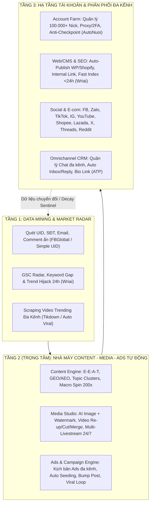
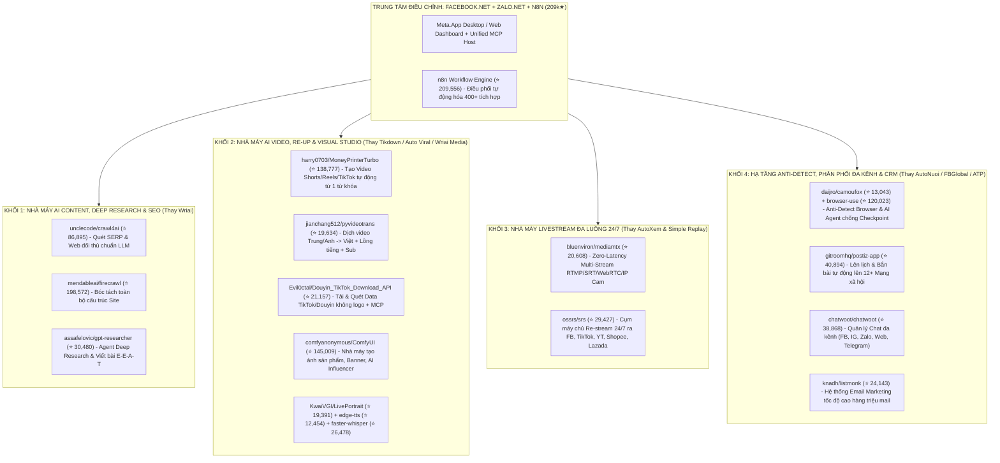

# Master Plan: Hệ Sinh Thái Tự Động Hóa Marketing & Nhà Máy Content, Media, Ads Tự Động

Tài liệu này tổng hợp **100% danh sách tính năng** được bóc tách trực tiếp từ 5 nền tảng mục tiêu (`AutoNuoi`, `FBGlobal`, `AutoXem`, `ATP Software`, `Wriai.com`) và quy hoạch thành một **Master Plan** thống nhất, đặt **Nhà máy Content – Media – Ads Tự động (Autonomous Content, Media & Ads Factory)** làm lõi trung tâm.

---

## Kiến Trúc Tổng Thể Hệ Sinh Thái (System Architecture)

---

## PHẦN I: TRỌNG TÂM CỐT LÕI — NHÀ MÁY CONTENT, MEDIA & ADS TỰ ĐỘNG (CORE FACTORY PLAN)

> [!IMPORTANT]
> Đây là trái tim của toàn bộ hệ thống: biến dữ liệu thô (từ khóa, xu hướng, tệp khách hàng đối thủ) thành **Content chuẩn SEO/Viral**, **Media (Ảnh/Video/Livestream)** và **Chiến dịch Ads/Distribution tự động 100%** không cần thao tác tay lặp lại.

### 1. Nhà Máy Sản Xuất Content Tự Động (Autonomous Content Factory)
Kết hợp sức mạnh **Autonomous AI SEO/GEO Engine của Wriai** và **Macro Content Spin của AutoNuoi/FBGlobal**:

* **Nghiên cứu & Lập kế hoạch tự động (Research & Topic Clustering):**
  * **GSC Striking Distance Radar:** Quét Google Search Console tìm từ khóa hạng 4–20 và từ khóa Impression cao nhưng CTR thấp để tối ưu đẩy lên Top 1–3.
  * **AI Market Radar & Competitor Content Gap:** Quét đối thủ cùng ngành tìm khoảng trống nội dung (Low KD, High Intent) và từ khóa ngách.
  * **Topic Cluster Architecture:** Tự động lập cấu trúc **1 Pillar Post + 4–6 Cluster Posts** bao phủ toàn bộ Topical Authority.
  * **Lịch biên tập tự động 30–60–90 ngày (Autopilot Content Calendar):** Lên kế hoạch và tự động chạy hàng ngày (ví dụ 08:00 AM).
* **3 Chế độ Viết bài AI Chuyên sâu (3 AI Writing Modes):**
  * **Mode 1 – Keyword Focus (Chuẩn 5-Tier E-E-A-T):** Dựng dàn ý H2/H3 từ Live SERP Scraping (chống ảo giác/hallucination), tự tạo Author Persona, TOC và **FAQ Schema JSON-LD**.
  * **Mode 2 – News Hijack 24h:** Bắt trend tin tức thời gian thực trong 24h để kéo traffic đột biến.
  * **Mode 3 – Comparison & GEO/AEO Entity Optimization:** Chuẩn hóa thực thể (Entity Graph) và dữ liệu kiểm chứng để bài viết được trích dẫn (citation) trên **ChatGPT, Perplexity, AI Overviews**.
* **Biến thiên Nội dung Quảng cáo & Social (Ad Copy & Macro Spin Engine):**
  * **Macro lồng nhau (Nested Spintax/Macro):** Soạn 1 tin gốc, tự động biến thiên thành **200+ phiên bản nội dung khác nhau** (thay đổi tiêu đề SEO, câu dẫn, cá nhân hóa tên người nhận) để đăng hàng loạt tài khoản/hội nhóm mà không bị đánh spam.
  * **AI Humanizer & Paraphraser:** Làm mượt văn phong theo Brand Voice, vượt bộ lọc AI detection.
  * **WooCommerce / E-commerce Product SEO:** Tự động viết tên sản phẩm, mô tả chi tiết, meta tags và alt ảnh cho toàn bộ giỏ hàng.
* **Tự động Phục hồi Nội dung Tụt hạng (Content Decay Sentinel):**
  * Giám sát biến động thứ hạng & click; tự động **1-Click AI Refresh** (cập nhật số liệu mới, tối ưu lại tiêu đề/H2) khi bài viết có dấu hiệu giảm traffic.

---

### 2. Nhà Máy Sản Xuất & Phát Sóng Media Tự Động (Autonomous Media & Livestream Studio)
Kết hợp **Visual Pipeline của Wriai**, **Video Processing & Multi-Stream của AutoXem** và **Tikdown/Viral Video của ATP**:

* **Pipeline Hình ảnh AI Tự động (AI Visual Media Pipeline):**
  * **Contextual AI Image Generation:** Tự động sinh ảnh minh họa gốc (WebP chất lượng cao) khớp với từng thẻ H2/H3 trong bài viết hoặc bài đăng quảng cáo.
  * **Auto Brand Watermark & SEO Metadata:** Tự động đóng dấu logo thương hiệu (Overlay), đặt tên file chuẩn SEO (slug) và điền thẻ Alt tự động.
  * **Random Media Mixing:** Tự động trộn ngẫu nhiên kho ảnh/video khi đăng hàng loạt lên hàng nghìn tài khoản (tránh trùng MD5/hash).
* **Xử lý, Thu thập & Tái chế Video Ngắn (Short-form Video Re-engineering):**
  * **Auto Scraping & No-Watermark Download:** Quét và tải hàng loạt video trending từ TikTok, YouTube, Facebook (theo từ khóa, kênh, playlist) không dính logo (`Simple Tikdown`, `AutoXem`).
  * **Batch Video Editor & Converter:** Cắt ghép nhanh, chèn hình ảnh, chèn nhạc nền, thêm hiệu ứng chuột (smart mouse), gắn Camera Overlay, đóng dấu Watermark thương hiệu.
  * **Universal Format Transcoder:** Chuyển đổi hàng loạt mọi định dạng video/audio Full HD 1080p (`mov, mp2, m2a, mpa, mp3, mp4, mpg, mpeg, wtv, wv, y4m...`), tách âm thanh tự động.
* **Hệ thống Phát Sóng Livestream Đa Kênh 24/7 (`AutoXem` & `Simple Live`):**
  * **Multi-Platform Simulcast:** Phát trực tiếp đồng thời lên **Facebook (Profile, Group, Fanpage), YouTube, TikTok, Instagram, Twitter (X), Lazada, Shopee...**
  * **Multi-Account Concurrent Streaming:** Chạy livestream cùng lúc trên không giới hạn số lượng tài khoản.
  * **24/7 Loop Re-stream (Phát lại như Live thật):** Dùng video quay sẵn, link YouTube/Facebook hoặc phiên live cũ để phát lại lặp đi lặp lại cả ngày lẫn đêm; hẹn giờ tự phát và tự tắt máy khi xong.
  * **E-commerce Packing Video Recorder (`Simple Replay`):** Tự động ghi hình quy trình đóng gói đơn hàng Shopee, Lazada, TikTok Shop làm bằng chứng đối soát và tư liệu truyền thông.

---

### 3. Nhà Máy Chiến Dịch Quảng Cáo, Seeding & Phân Phối Tự Động (Autonomous Ads & Viral Engine)
Kết hợp khả năng **Outreach quy mô lớn của AutoNuoi + FBGlobal + ATP** và **Closed-Loop Distribution của Wriai**:

* **Chiến dịch Đăng bài & Rải Quảng cáo Đa Kênh (Mass Ad Publishing):**
  * Tự động đăng bài bán hàng (nhiều mặt hàng, kích cỡ, mẫu mã) lên hàng loạt Profile, Tường bạn bè, hàng nghìn Group (tự lọc bỏ nhóm duyệt bài) và hệ thống Fanpage vệ tinh.
  * **Tư cách Fanpage Admin (`FBGlobal`):** Dùng hàng loạt Fanpage đi tham gia nhóm, đăng bài vào nhóm, like/comment và đẩy tin hoàn toàn dưới danh nghĩa Page để phủ thương hiệu.
  * **Omnichannel Social Syndication (`Wriai`):** Ngay khi bài viết/chiến dịch xuất bản trên CMS, tự động băm nhỏ (repurpose) và bắn lên **8–10+ kênh mạng xã hội** (Facebook, LinkedIn, Meta Threads, X/Twitter, Reddit, Bluesky, Tumblr, Mastodon) để kéo Referral Traffic tức thì.
* **Hệ thống Seeding, Hiệu ứng Đám đông & Đẩy Top Tự động (Automated Seeding & Bump Engine):**
  * **Auto Up Tin / Bump Post:** Tự động like, comment điểm chấm/nội dung mồi để đẩy bài quảng cáo cũ lên Top đầu của Group, Fanpage, Tường cá nhân liên tục.
  * **Tương tác chéo nội bộ (Cross-Account Seeding):** Khi 1 tài khoản trong hệ thống đăng bài quảng cáo, các tài khoản khác tự động vào like, thả tim, bình luận mồi theo kịch bản hỏi–đáp.
  * **Livestream Seeding (`AutoNuoi` + `Simple Live`):** Tăng mắt xem livestream ảo/thật, chạy kịch bản hàng loạt nick vào bình luận chốt đơn giả lập trên TikTok Live / Facebook Live để giữ chân người xem và kích thích mua hàng.
  * **Tăng chỉ số uy tín (`VN Follow` / `AutoNuoi`):** Tự động tăng Like Page, Follow Profile, Like/Comment bài viết, Share Livestream vào hội nhóm, kéo view YouTube và kéo traffic về Website.
* **Quảng cáo Trực tiếp Tệp Nóng (Direct Outreach Ads - Inbox / Comment / Email):**
  * **Mass Comment Ads:** Tự động rải bình luận quảng cáo kèm ảnh vào bài viết của bạn bè, bài trong nhóm, bài đầu tiên của Page đối thủ, hoặc tường của danh sách UID mục tiêu.
  * **Mass Direct Message (Inbox) Ads:** Nhắn tin quảng cáo/chăm sóc hàng loạt tới bạn bè, Fanpage, thành viên nhóm, danh sách UID lạ hoặc SĐT trên Zalo (`Simple Zalo`).
  * **Multi-threaded Email Marketing (`FBGlobal`):** Quét email theo khu vực/ngành nghề/từ khóa và gửi chiến dịch Email quảng cáo đa luồng tốc độ cao.

---

## PHẦN II: DANH MỤC TÍNH NĂNG CHI TIẾT TỪ 5 NỀN TẢNG THAM CHIẾU

Dưới đây là bảng kiểm kê đầy đủ từng tính năng của 5 trang web để đảm bảo không bỏ sót bất kỳ module kỹ thuật nào khi thiết kế hệ thống:

### 1. Hệ thống `AutoNuoi` (https://www.autonuoi.com/autonuoi.html)
Chuyên trách: **Quản lý 100.000+ tài khoản, nuôi nick chống checkpoint & tự động hóa hành động theo kịch bản tháng.**

1. **Quản lý tự động hàng nghìn – 100.000 tài khoản thông minh:**
   * Đăng nhập hàng trăm/nghìn tài khoản chỉ với 1 click.
   * Lưu, nạp và tự động nhận diện định dạng tài khoản từ file `.txt`, `.xlsx`, `.csv`.
   * Đồng bộ hàng loạt tài khoản từ các trình duyệt: Chrome, Cốc Cốc, Firefox, Opera, Microsoft Edge.
   * Tự động kiểm tra trạng thái hoạt động (live/checkpoint/die), cập nhật và chỉnh sửa thông tin tài khoản (avatar, cover, bio, mật khẩu...).
   * Quản lý phân cấp theo thư mục mô tả (nhiều loại nick khác nhau).
   * Gán Proxy riêng biệt cho từng tài khoản (hỗ trợ đầy đủ HTTP/HTTPS, Socks4, Socks5) và tích hợp lấy mã bảo mật **2FA**.
   * Cơ chế chạy đa luồng cuốn chiếu: chạy hết lô tài khoản đã chọn tự động chuyển sang lô tiếp theo không cần can thiệp.
   * Backup toàn bộ dữ liệu và phiên đăng nhập tài khoản.
2. **Thiết lập Hành động & Kịch bản chạy (1 lần cho cả tháng):**
   * Xây dựng kịch bản riêng biệt cho từng tài khoản (mỗi nick 1 kịch bản, 1 proxy, 1 profile trình duyệt riêng).
   * Phân loại kịch bản dành cho **Nick mới** và kịch bản dành cho **Nick lâu năm**.
   * Cơ chế thực thi linh hoạt: chạy cuốn chiếu, luân phiên, ngẫu nhiên hoặc theo tỷ lệ % thiết lập.
   * **Anti-Checkpoint Guard:** Tự động phát hiện bất thường khi đang chạy và chuyển trạng thái nghỉ để ngăn chặn checkpoint hàng loạt.
   * Quản lý tin đăng khoa học: soạn 1 lần đăng cho nhiều nick, biến thiên 200 lần nội dung, random hình ảnh/video.
3. **Tương tác & Mở rộng tệp bạn bè tự động:**
   * Tự động lướt Newsfeed bạn bè, Newsfeed Nhóm, Newsfeed Page; tự động like, thả tim, xem video.
   * Tự động chấp nhận lời mời kết bạn đã gửi đến.
   * Tìm và kết bạn tự động theo gợi ý, theo khu vực, giới tính, độ tuổi, ngành nghề hoặc theo tệp UID.
   * Tự động hủy yêu cầu kết bạn đã gửi khi chạm ngưỡng giới hạn của Facebook.
   * Hẹn giờ tương tác (theo thứ tự, ngẫu nhiên hoặc theo tỷ lệ %).
4. **Đăng bài, Bình luận & Nhắn tin quảng cáo hàng loạt:**
   * Đăng bài lên tường cá nhân, tường bạn bè, hội nhóm số lượng lớn, tường nhiều Fanpage cùng lúc.
   * Tự động Share bài viết, Share Livestream bán hàng vào group.
   * Tự động bình luận lên bài bạn bè, bài trong nhóm, bài đầu tiên của Page, bài của UID bất kỳ.
   * Tự động nhắn tin hàng loạt cho bạn bè, nhắn tin cho nhiều Page, nhắn tin cho UID lạ (chưa kết bạn).
   * Quản lý lịch sử đăng bài, bình luận, nhắn tin và hẹn giờ chi tiết.
5. **Quản lý Hội nhóm (Group):**
   * Tự động tìm nhóm, tham gia nhóm, tự động **loại bỏ nhóm cần phê duyệt**.
   * Đánh giá và lọc nhóm có thành viên đông, tương tác cao; tự động rời nhóm ít tương tác.
   * Mời bạn bè vào nhóm hoặc mời bạn bè like Fanpage hàng loạt.
6. **Seeding & Khai thác dữ liệu khách hàng tiềm năng:**
   * Tăng like Fanpage, tăng follow cá nhân, tăng like/comment bài viết bất kỳ, tăng mắt xem Livestream, kéo traffic web & view YouTube.
   * Quét khách hàng theo khu vực, độ tuổi, giới tính, ngành nghề, sở thích, bạn của bạn bè, quét khách đối thủ & khách hàng realtime (kể cả quét SĐT và bình luận ẩn).

---

### 2. Hệ thống `FBGlobal` (https://www.autonuoi.com/fbglobal.html)
Chuyên trách: **Khai thác Big Data khách hàng (Data Mining), Vận hành với tư cách Page Admin & Tự động hóa tương tác chéo.** (Tích hợp 7 version trong 1: Nuôi nick, Tương tác tự động, Quản lý bạn bè, Lọc/tham gia nhóm, Lọc/thích page, Đăng tường, UserID nâng cao).

1. **Quét Số Điện Thoại & Dữ liệu Bình luận (Data Mining):**
   * Tìm số điện thoại công khai theo khu vực địa lý, ngành nghề kinh doanh, từ khóa, trang Fanpage.
   * Quét toàn bộ Like, Comment (UserID, nội dung, SĐT để lại) của bất kỳ bài viết nào trên: Trang cá nhân, Fanpage, **Bài đang chạy quảng cáo (Ads)**, **Livestream**, và Bài trong Group.
2. **Vận hành Авто với tư cách Fanpage Admin (Page-as-Actor):**
   * Không giới hạn số lượng Fanpage đưa vào phần mềm.
   * Dùng tư cách Fanpage quản trị để: tự động tìm nhóm, tham gia nhóm, đăng bài lên nhóm, tự động like/comment và up tin mở rộng tương tác.
   * Tự động share bài viết bất kỳ lên trang cá nhân/Fanpage, share Fanpage để tăng lượt like.
3. **Auto Comment trả lời khách hàng & Auto Up Tin (Bump Post):**
   * Tự động trả lời mọi câu hỏi của khách hàng trên tường cá nhân, tường bạn bè, bài quảng cáo nhóm và bài quảng cáo Page.
   * Tự động like, comment làm mới tin (Up tin lên top) trên tường cá nhân, tường bạn bè, nhóm và Page.
4. **Tương tác chéo giữa các tài khoản (Cross-Account Interaction):**
   * Khi một tài khoản đang chạy trên FBGlobal đăng bài (lên cá nhân, tường bạn bè, nhóm, hoặc page), các tài khoản khác trong hệ thống tự động nhảy vào like và comment đẩy tương tác.
5. **Email Marketing & Quét Email tự động:**
   * Tự động tìm kiếm email theo khu vực, ngành nghề, từ khóa.
   * Nạp mọi định dạng file email, hỗ trợ mọi cấu hình SMTP/Email và gửi email đa luồng tốc độ cao.
6. **Khai thác sâu Mạng lưới Bạn bè, Group, Page & UserID:**
   * Tìm và kết bạn theo vị trí địa lý, giới tính, tình trạng hôn nhân, độ tuổi, nơi sống, nơi làm việc; lọc tương tác bạn bè (số like, comment, thời gian đăng).
   * Quét danh sách bạn của bạn bè (lưu offline, lọc thông tin, kiểm tra tương tác với mình).
   * Liệt kê toàn bộ thành viên của 1 nhóm bất kỳ, lọc thông tin, tự động kết bạn hoặc nhắn tin hàng loạt cho thành viên nhóm.
   * Liệt kê các Page đã thích, tìm Page theo ngành nghề, tự động thích/bỏ thích Page, đăng bài lên tường Page và nhắn tin cho tất cả các Page.
   * Quản lý tệp UserID: quét dòng thời gian của UID, tìm bạn bè của UID, lấy thông tin công khai, kiểm tra mức độ tương tác và nhắn tin tự động.
7. **Bộ soạn thảo Macro nâng cao:**
   * Hỗ trợ Macro lồng nhau tạo chỉnh hợp ngẫu nhiên (thay thế tên đối tượng, biến thiên tiêu đề SEO A/B/C...), soạn 1 lần đăng 200 lần nội dung khác biệt.

---

### 3. Hệ thống `AutoXem` (https://www.autonuoi.com/autoxem.html)
Chuyên trách: **Livestream đa nền tảng, Re-stream 24/7 và Xử lý/Biên tập Video.**

1. **Livestream Facebook toàn diện:**
   * Phát trực tiếp đa luồng lên Profile cá nhân, nhiều Group và Fanpage Admin bằng nhiều tài khoản cùng lúc.
   * Quay video trực tiếp và phát ngay trên phần mềm; hẹn giờ phát live và tự động tắt máy tính sau khi live xong.
2. **Livestream Đa Sàn & Đa Mạng Xã Hội:**
   * Phát đồng thời lên **Lazada, YouTube, TikTok, Instagram, Twitter (X)...**
   * Nguồn phát linh hoạt: lấy trực tiếp từ link YouTube, link Facebook, tệp video có sẵn trong máy hoặc quay trực tiếp.
3. **Phát lại Livestream (Re-stream) & Hẹn giờ:**
   * Phát lại video đã quay/chỉnh sửa hoàn chỉnh hoặc phát lại phiên Livestream cũ lên đa nền tảng như một luồng live trực tiếp mới.
   * Không giới hạn số lượng tài khoản YouTube, Facebook... chạy đồng thời.
4. **Biên tập Video & Chuyển đổi Định dạng (Video Studio):**
   * Cắt, ghép video nhanh chóng; tùy chọn hiệu ứng trỏ chuột (mouse) thông minh.
   * Thêm lớp phủ webcam (**Camera Overlay**), đóng dấu **Watermark** thương hiệu, chèn hình ảnh và nhạc nền vào video.
   * Chuyển đổi mọi định dạng video/audio chất lượng Full HD 1080p sang: `mov, mp2, m2a, mpa, mp3, mp4, mpg, mpeg, wtv, wv, y4m...`

---

### 4. Hệ sinh thái `ATP Software` (https://atpsoftware.vn/tong-hop-san-pham)
Chuyên trách: **Tổ hợp công cụ Marketing Đa Kênh (Facebook, Zalo, TikTok, Instagram, Shopee/Lazada) & Quản trị Hội thoại.**

| Tên sản phẩm | Nhóm kênh | Tính năng chi tiết cần tích hợp vào Master Plan |
| :--- | :--- | :--- |
| **Simple FB Pro & Simple FB Mobile** | Facebook (PC & Mobile) | Tự động hóa toàn bộ thao tác tay trên trình duyệt & điện thoại; kịch bản nuôi nick dựng sẵn chống checkpoint; kết bạn khách hàng tiềm năng; tự động like/comment; **lọc và hủy kết bạn không tương tác**. |
| **Simple UID** | Facebook Data | Quét UID miễn phí/nâng cao: UID profile, UID thành viên nhóm, UID người like/comment bài viết bất kỳ. |
| **Auto Viral Content** | Facebook Page / Multi-Video | Quản lý Fanpage số lượng lớn; tự động tìm, đặt lịch và đăng lại video Trending từ các kênh lên hàng loạt Fanpage theo lịch trình soạn sẵn. |
| **Simple Tikdown** | TikTok / Shorts / Reels | Tải video TikTok số lượng lớn **không dính logo/watermark**; đặt lịch đăng video tự động để xây dựng kênh đa nền tảng (YouTube Shorts, FB Reels, Instagram). |
| **Simple Live** | TikTok Livestream | Tạo kịch bản bình luận seeding livestream TikTok; điều khiển hàng loạt tài khoản vào tương tác giữ chân người xem ở lại phiên live lâu hơn. |
| **Simple Zalo** | Zalo Marketing | Xây dựng profile Zalo bán hàng; tự động kết bạn (theo SĐT/gợi ý); gửi tin nhắn chăm sóc khách hàng hàng loạt; mời bạn bè tham gia nhóm Zalo. |
| **Simple Instagram** | Instagram | Quản lý hàng loạt tài khoản IG; tạo kho thư viện bài viết; tự động follow người dùng theo từ khóa, nhắn tin và nuôi nick. |
| **Simple Chat Pro** | Omnichannel CRM | Quản lý tin nhắn và bình luận đa kênh (Mạng xã hội & Sàn TMĐT) tập trung trên 1 giao diện duy nhất. |
| **Simple Replay** | Shopee, Lazada, TikTok Shop | Ứng dụng ghi hình tự động quy trình đóng gói hàng hóa kèm mã vận đơn để chống gian lận/khiếu nại hoàn hàng. |
| **ATP Link** | Bio Link / Micro-Web | Tạo trang Bio Link / Landing Page bán hàng nhanh trong 30 phút theo mẫu có sẵn, tích hợp giỏ hàng và xử lý đơn hàng tiện lợi. |
| **VN Follow** | Đa kênh Seeding | Hệ thống buff/seeding chéo tăng tương tác cho Facebook, TikTok, Instagram, YouTube. |

---

### 5. Hệ thống `Wriai` (https://wriai.com/)
Chuyên trách: **Autonomous AI SEO & GEO Engine — Tự động hóa khép kín 100% vòng đời Content & SEO.**

1. **Golden Opportunity Engine & AI Market Radar:**
   * **Search Console Radar:** Kết nối trực tiếp GSC, tìm từ khóa vị trí 4–20 ("Striking Distance") và từ khóa Impression cao – CTR thấp.
   * **Keyword Research & Cannibalization:** Phân tích Volume, CPC, KD, Search Intent và phát hiện các trang đang tự cạnh tranh cùng 1 từ khóa (Keyword Cannibalization).
   * **AI Market Radar:** Quét đối thủ tìm Content Gaps và xu hướng mới có KD thấp.
   * **Rank Tracking:** Theo dõi thứ hạng Top 30 Google hàng ngày theo quốc gia và thiết bị.
2. **Autonomous E-E-A-T Content Studio:**
   * Xây dựng **Topic Clusters** (1 Pillar + 4–6 Clusters) và lên lịch chạy tự động 30–60–90 ngày.
   * **3 chế độ viết:** Keyword Focus, News Hijack 24h, Comparison / GEO Entity AI (tối ưu để được trích dẫn bởi ChatGPT & Perplexity).
   * **Live SERP Grounding:** Quét kết quả Google thời gian thực để kiểm chứng sự thật (100% Fact-checked, chống ảo giác), chèn Author Persona + FAQ Schema JSON-LD.
   * **SEO Visual Media Pipeline:** Tự tạo ảnh AI WebP theo từng đoạn H2/H3, tự đóng dấu Watermark logo, tự đặt SEO slug & thẻ Alt, lưu trữ trên S3 CDN hoặc host riêng.
   * **WooCommerce Product SEO:** Tối ưu hàng loạt tên, mô tả, meta và alt ảnh cho sản phẩm TMĐT.
3. **Direct CMS Auto-Publish & 24h Fast Indexing:**
   * Kết nối 1-Click qua REST API / Webhook tới **WordPress (100% Native Gutenberg Clean Blocks), Shopify, Webflow, Wix, Ghost**. Tự động gắn danh mục, tags, TOC, SEO slug.
   * **Google Fast Indexing API:** Tự động ping `indexing-api.google.com` ngay khi đăng bài để bot Google index trong **< 24 giờ**.
4. **Semantic Link Building Engine:**
   * **Reverse Internal Links (Back-Linking tự động):** Tự động quét các bài viết cũ trên web và chèn ngữ cảnh anchor text trỏ ngược về bài viết mới vừa xuất bản (xóa bỏ 100% orphan pages).
   * **Verified Partner Link Exchange Network:** Mạng lưới trao đổi backlink ngữ cảnh (In-content DoFollow) tự nhiên giữa các domain cùng ngách đã xác minh (kiểm soát 3–5 link/tháng/site, kiểm tra uptime link 24/7, an toàn trước thuật toán Penguin).
5. **Viral Social Distribution & Content Decay Sentinel:**
   * Tự động phân phối bản tóm tắt hấp dẫn lên **8–10+ mạng xã hội** (Facebook, LinkedIn, Threads, Bluesky, X, Reddit, Tumblr, Mastodon) ngay khi CMS đăng bài.
   * **Content Decay Sentinel:** Tự động phát hiện bài viết bị tụt hạng/giảm click trên GSC và làm mới bằng AI chỉ với 1 click.
   * **47+ Free/Built-in SEO Tools & Developer API:** Website Value Calculator, DA Checker, Backlink Gap Analyzer, Spam Score Checker, Entity Extractor, E-E-A-T Outline Generator, AI Humanizer, Technical SEO Audit, Core Web Vitals, Schema Validator, cùng hệ thống Webhook/API cho lập trình viên.

---

## PHẦN III: LỘ TRÌNH TRIỂN KHAI (IMPLEMENTATION PHASES)

Để xây dựng tổ hợp siêu nền tảng này với trọng tâm là **Nhà máy Content – Media – Ads Tự động**, dự án được chia làm 4 giai đoạn (Phases):

### Giai đoạn 1: Xây dựng Lõi "Nhà Máy Content & Media AI" (Core Content & Media Factory)
* Thiết lập **AI Content Engine** (Live SERP Scraping, Topic Cluster Planner 30–90 ngày, 3 chế độ viết E-E-A-T / News Hijack / GEO, Spintax Macro 200x).
* Xây dựng **Media Automation Pipeline**:
  * Tự sinh ảnh AI + đóng dấu Watermark + tối ưu WebP/Alt/Slug.
  * Module tải video đa kênh không watermark (TikTok/FB/YT) + FFmpeg Batch Processor (cắt ghép, chèn nhạc, overlay, đổi định dạng, trộn hash MD5).
* Kết nối **1-Click CMS Publishing** (WordPress, Shopify, Webhook) + **Google Indexing API (<24h)** + **Reverse Internal Linking**.

### Giai đoạn 2: Xây dựng "Nhà Máy Chiến Dịch Ads, Livestream & Phân Phối Đa Kênh" (Ads & Distribution Engine)
* Xây dựng **Multi-Channel Dispatcher**: Tự động biến đổi (repurpose) 1 bài gốc thành bài đăng cho Facebook, Zalo, TikTok, Instagram, Threads, X, LinkedIn, Reddit, YouTube.
* Xây dựng **Multi-Stream Engine (`AutoXem` Core)**: Phát livestream và Re-stream 24/7 từ video có sẵn lên Facebook, TikTok, YouTube, Shopee, Lazada đa luồng.
* Xây dựng **Campaign & Seeding Scheduler**: Kịch bản rải bài Group/Page, Auto Up tin (Bump post), kịch bản Seeding Livestream và tương tác chéo giữa các tài khoản.

### Giai đoạn 3: Xây dựng Hạ tầng Nuôi Nick & Khai thác Dữ liệu (Account Farm & Data Mining)
* Xây dựng **Multi-Account Browser/API Controller (`AutoNuoi` Core)**: Quản lý hàng nghìn tài khoản, tích hợp Anti-detect Profile, Proxy Pool (HTTP/Socks5), Auto 2FA, kịch bản nuôi nick chống checkpoint.
* Xây dựng **Data Mining Radar (`FBGlobal` + `Simple UID` + `Wriai Radar`)**: Quét UID, SĐT, Email từ bình luận Ads/Livestream/Group, kết hợp GSC Radar & Competitor Gap.

### Giai đoạn 4: Quản trị Chuyển đổi, CRM Đa Kênh & Vòng lặp Tối ưu (Omnichannel CRM & Closed-Loop Optimization)
* Xây dựng **Unified Inbox (`Simple Chat`) & Auto-Responder**: Gom toàn bộ comment/inbox từ FB, Zalo, IG, TikTok, TMĐT về một màn hình; tích hợp AI Chatbot tự động trả lời & chốt đơn.
* Tích hợp tiện ích bổ trợ: **Bio Link Builder (`ATP Link`)**, **Packing Recorder (`Simple Replay`)**, **Content Decay Sentinel** và **Link Exchange Network**.

---

## PHẦN IV (FINAL COMMERCIAL AUDIT): HỆ SINH THÁI 18 SIÊU REPO MÃ NGUỒN MỞ NGHÌN SAO (12.000★ – 209.000★) ĐỂ THƯƠNG MẠI HÓA

> [!IMPORTANT]
> **Kết luận Audit Thương mại hóa:**
> Các thư viện C# đơn lẻ (`ImageSharp`, `AngleSharp`, `MailKit`...) chỉ là tầng "ốc vít" nội bộ, **tuyệt đối không đủ sức tạo ra sản phẩm thương mại hóa** cạnh tranh với `Wriai`, `AutoNuoi`, `FBGlobal`, `AutoXem`, `ATP Software`.
> Để đạt chất lượng thương mại hóa ngay lập tức mà **chi phí bản quyền vẫn bằng 0đ**, hệ thống phải đứng trên vai **18 "Gã khổng lồ" Open-Source (từ 12.000★ đến 209.000★ trên GitHub)** và kết nối chúng vào `Facebook.Net` + `Zalo.Net` thông qua **MCP Protocol / Local REST API / Sidecar Worker**.

### Kiến Trúc Kết Nối Liên Hợp (Commercial Federation Architecture)

---

### Bảng Ma Trận 18 Siêu Repo Nghìn Sao Được Chọn (Đã Kiểm Chứng Thực Tế)

#### 1. Nhóm Nhà Máy Sản Xuất Video Ngắn, Re-up Đa Quốc Gia & AI Studio (Thay thế vượt trội `Simple Tikdown`, `Auto Viral Content`, `AutoXem Video`)

| # | Repository GitHub | Số Sao Thực Tế | Giải quyết bài toán Thương mại hóa gì? | Cách kết nối vào Hệ thống |
| :- | :--- | :--- | :--- | :--- |
| 1 | **[`harry0703/MoneyPrinterTurbo`](https://github.com/harry0703/MoneyPrinterTurbo)** | **⭐ 138,777** | **Nhà máy in Video Shorts/Reels/TikTok tự động số 1 thế giới:** Chỉ cần ném vào 1 từ khóa/chủ đề, tự động viết kịch bản, đọc lồng tiếng AI, tạo phụ đề hiệu ứng đẹp, tự tìm và ghép video nền HD không bản quyền, chèn nhạc nền, xuất hàng loạt. | Gọi trực tiếp qua **FastAPI REST API** tích hợp sẵn của repo (`POST /api/v1/videos`). |
| 2 | **[`comfyanonymous/ComfyUI`](https://github.com/comfyanonymous/ComfyUI)** | **⭐ 145,009** | **Nhà máy Hình ảnh Quảng cáo & AI Influencer chuẩn Studio:** Tạo ảnh sản phẩm thương mại điện tử, thay nền sản phẩm, giữ nguyên khuôn mặt mẫu ảo (Consistent Character), tạo ảnh bài viết chuẩn SEO và đóng dấu Watermark tự động. | Kết nối qua **ComfyUI WebSocket/REST API** (hoặc chạy workflow JSON headless). |
| 3 | **[`Evil0ctal/Douyin_TikTok_Download_API`](https://github.com/Evil0ctal/Douyin_TikTok_Download_API)** | **⭐ 21,157** | **Hệ thống Cào Data & Tải Video TikTok / Douyin / Bilibili Không Logo cấp độ Enterprise:** Vượt xa `yt-dlp` đơn thuần khi đối phó với thuật toán chặn `X-Bogus` / `a_bogus` của TikTok/Douyin; quét toàn bộ thông tin kênh, bình luận, nhạc hot và **hỗ trợ sẵn MCP Server**. | Kết nối trực tiếp qua **MCP Server** hoặc REST API nội bộ. |
| 4 | **[`jianchang512/pyvideotrans`](https://github.com/jianchang512/pyvideotrans)** | **⭐ 19,634** | **Vũ khí "Việt hóa" Video Bán hàng Quốc tế:** Tự động nhận diện giọng nói video tiếng Trung (Douyin/Taobao/1688) hoặc tiếng Anh, dịch sang tiếng Việt chuẩn ngữ cảnh bán hàng, lồng tiếng Việt khớp khẩu hình và đóng cứng phụ đề mới. | Chạy CLI / API Worker xử lý tự động ngay sau khi `Douyin_TikTok_Download_API` tải video về. |
| 5 | **[`linyqh/NarratoAI`](https://github.com/linyqh/NarratoAI)** | **⭐ 11,713** | **AI Tự động Xem, Thuyết minh & Cắt Highlight Video:** Dùng Vision LLM tự xem video dài/video sản phẩm, tự viết lời bình thuyết minh bán hàng/review và tự cắt ghép thành clip ngắn viral. | Kết nối qua API microservice nội bộ. |
| 6 | **[`KwaiVGI/LivePortrait`](https://github.com/KwaiVGI/LivePortrait)** | **⭐ 19,391** | **Tạo MC / Streamer Ảo từ 1 bức ảnh tĩnh:** Biến 1 bức ảnh người mẫu thành video nói chuyện, biểu cảm khuôn mặt cực kỳ tự nhiên để làm video quảng cáo hoặc phát Livestream 24/7 không cần thuê người thật. | Kết nối pipeline với `edge-tts` để tạo video MC bán hàng. |
| 7 | **[`SYSTRAN/faster-whisper`](https://github.com/SYSTRAN/faster-whisper)** + **[`rany2/edge-tts`](https://github.com/rany2/edge-tts)** | **⭐ 26,478** + **⭐ 12,454** | **Bộ đôi Tách kịch bản đối thủ (ASR) & Giọng đọc AI Tiếng Việt (TTS) 0đ:** `faster-whisper` bóc toàn bộ lời nói từ 100 video đối thủ thành văn bản trong vài giây; `edge-tts` tạo giọng đọc Nam/Nữ Tiếng Việt chuẩn tự nhiên hoàn toàn miễn phí. | Gọi trực tiếp qua Python Worker / CLI. |

---

#### 2. Nhóm Nhà Máy AI SEO, Deep Research & Cào Dữ Liệu Chống Chặn (Thay thế vượt trội `Wriai.com` & `FBGlobal Data Mining`)

| # | Repository GitHub | Số Sao Thực Tế | Giải quyết bài toán Thương mại hóa gì? | Cách kết nối vào Hệ thống |
| :- | :--- | :--- | :--- | :--- |
| 8 | **[`mendableai/firecrawl`](https://github.com/mendableai/firecrawl)** | **⭐ 198,572** | **Engine Quét toàn bộ Cấu trúc Website Đối thủ & Chuyển thành LLM-Ready Data:** Tự động cào toàn bộ Sitemap, cấu trúc Internal Link, bài viết Top đầu của đối thủ thành Markdown/JSON sạch tuyệt đối. | Self-host API nội bộ phục vụ `AI Market Radar` & `Competitor Content Gap`. |
| 9 | **[`unclecode/crawl4ai`](https://github.com/unclecode/crawl4ai)** | **⭐ 86,895** | **Trình cào dữ liệu Web & SERP tốc độ cao dành riêng cho AI Agent:** Tích hợp sẵn cơ chế vượt chặn, bóc tách Entity, bảng biểu, giá sản phẩm, FAQ từ Top 10 Google theo thời gian thực (**Live SERP Grounding**). | Tích hợp trực tiếp làm lõi thu thập dữ liệu cho AI viết bài. |
| 10 | **[`assafelovic/gpt-researcher`](https://github.com/assafelovic/gpt-researcher)** | **⭐ 30,480** | **Autonomous Deep Research & E-E-A-T Article Engine:** Thay vì gọi 1 câu prompt hời hợt, Agent này tự lập dàn ý nghiên cứu, đọc song song 20+ nguồn uy tín, kiểm chứng chéo sự thật (Zero Hallucinations), trích dẫn nguồn và viết bài chuyên sâu 3.000+ từ chuẩn **E-E-A-T & GEO (ChatGPT/Perplexity Citation)**. | Nhúng làm lõi **Autonomous Content Studio** kết hợp với `agy` / Gemini. |

---

#### 3. Nhóm Hạ Tầng Trình Duyệt Anti-Detect, AI Browser Agent & Nuôi Nick Quy Mô Lớn (Thay thế vượt trội `AutoNuoi` & `Simple FB Pro`)

| # | Repository GitHub | Số Sao Thực Tế | Giải quyết bài toán Thương mại hóa gì? | Cách kết nối vào Hệ thống |
| :- | :--- | :--- | :--- | :--- |
| 11 | **[`daijro/camoufox`](https://github.com/daijro/camoufox)** | **⭐ 13,043** | **Trình duyệt Anti-Detect Mã Nguồn Mở ở tầng C++ (Tương đương Multilogin / GoLogin / Hidemyacc trả phí):** Tự động giả lập sâu (spoof) toàn bộ **Canvas, WebGL, AudioContext, Fonts, Screen, WebRTC, Navigator, TLS Fingerprint** cho từng tài khoản. Đây là yếu tố sống còn để nuôi 1.000–100.000 nick không bị Facebook/TikTok quét trùng thiết bị và đánh Checkpoint hàng loạt! | Thay thế/Bổ sung cho Chrome thường khi chạy đa tài khoản quy mô lớn. |
| 12 | **[`browser-use/browser-use`](https://github.com/browser-use/browser-use)** + **[`Skyvern-AI/skyvern`](https://github.com/Skyvern-AI/skyvern)** | **⭐ 120,023** + **⭐ 23,340** | **AI Browser Agent Tự Chữa Lỗi khi Facebook/TikTok đổi giao diện:** Các tool truyền thống (`AutoNuoi`, `ATP`) cứ mỗi lần Facebook/TikTok đổi mã HTML/CSS là chết cứng phải chờ bản vá. `browser-use` & `Skyvern` dùng Vision + DOM AI để tự nhìn màn hình và thao tác như người thật bất chấp giao diện thay đổi. | Làm lớp Fallback thông minh cho `Facebook.Net.Browser`. |

---

#### 4. Nhóm Phân Phối Đa Kênh, Livestream 24/7, CRM & Email Công Nghiệp (Thay thế `AutoXem`, `Wriai Social`, `Simple Chat`, `FBGlobal Email`)

| # | Repository GitHub | Số Sao Thực Tế | Giải quyết bài toán Thương mại hóa gì? | Cách kết nối vào Hệ thống |
| :- | :--- | :--- | :--- | :--- |
| 13 | **[`n8n-io/n8n`](https://github.com/n8n-io/n8n)** | **⭐ 209,556** | **Bộ não Điều phối Tự động hóa Khép kín (Closed-Loop Workflow Engine):** Kết nối sẵn hơn 400+ nền tảng (WordPress, Shopify, WooCommerce, Google Search Console, Telegram, Discord, Webhook...). Giúp thiết lập luồng: *Quét GSC -> Viết bài -> Tạo ảnh -> Đăng WP -> Ping Google Index -> Bắn ra 10 mạng xã hội* hoàn toàn trực quan. | Chạy Self-hosted kết nối trực tiếp với `Facebook.Net.Mcp` và `Zalo.Net.Mcp`. |
| 14 | **[`gitroomhq/postiz-app`](https://github.com/gitroomhq/postiz-app)** | **⭐ 40,894** | **Nền tảng Lên lịch & Phân phối Mạng Xã Hội bằng AI số 1 thế giới:** Hỗ trợ sẵn kết nối và đăng bài/video tự động lên **Facebook, Instagram, TikTok, YouTube, Threads, X (Twitter), LinkedIn, Reddit, Bluesky, Mastodon, Pinterest** kèm lịch biên tập 30–90 ngày và phân tích tương tác. | Kết nối qua REST API / Webhook để phân phối tự động (`Viral Social Distribution`). |
| 15 | **[`ossrs/srs`](https://github.com/ossrs/srs)** + **[`bluenviron/mediamtx`](https://github.com/bluenviron/mediamtx)** | **⭐ 29,427** + **⭐ 20,608** | **Cụm Máy chủ Livestream & Re-stream Đa Luồng Công Nghiệp (`AutoXem` Core):** Nhận 1 video hoặc 1 luồng live duy nhất và tự động nhân bản (re-stream) đồng thời ra 20+ kênh (nhiều Page, Group FB, TikTok, YouTube, Shopee, Lazada) 24/7 với mức tiêu thụ CPU bằng 1/10 so với chạy nhiều tiến trình lẻ; đồng thời thu luồng RTSP/WebRTC từ Camera đóng gói hàng (`Simple Replay`). | Điều khiển trực tiếp qua **HTTP Control API** từ C# (`Facebook.Net`). |
| 16 | **[`chatwoot/chatwoot`](https://github.com/chatwoot/chatwoot)** | **⭐ 38,868** | **Hệ thống Quản trị Hội thoại Đa kênh Thương mại (`Simple Chat Pro`):** Gom toàn bộ tin nhắn và bình luận từ Facebook Fanpage, Instagram, Website, Email, Telegram, WhatsApp và cổng API tùy chỉnh (nối trực tiếp `Zalo.Net`) về 1 màn hình duy nhất, hỗ trợ phân quyền nhân viên CSKH và AI Bot tự động chốt đơn. | Tích hợp qua Webhook & REST API với `Facebook.Net` và `Zalo.Net`. |
| 17 | **[`knadh/listmonk`](https://github.com/knadh/listmonk)** | **⭐ 24,143** | **Hệ thống Email Marketing Hiệu năng Cực cao (`FBGlobal Email`):** Viết bằng Go, tự host nhẹ nhàng, quản lý hàng triệu email thu thập được từ `FBGlobal Data Mining`, gửi chiến dịch đa luồng siêu tốc, hỗ trợ cá nhân hóa nội dung và thống kê tỷ lệ mở mail/click chuyên nghiệp. | Đẩy tệp Email quét được từ `Facebook.Net` sang `Listmonk REST API`. |
| 18 | **[`ppn-systems/Facebook.Net`](https://github.com/ppn-systems/Facebook.Net)** + **[`ppn-systems/Zalo.Net`](https://github.com/ppn-systems/Zalo.Net)** | **Core Nội Bộ** | **Vũ khí Độc quyền Thị trường Việt Nam (Facebook Group/Profile + Zalo Cá nhân):** Các repo quốc tế không có module chuyên sâu cho **Zalo cá nhân** và **Facebook Group Việt Nam (quét SĐT ẩn, đăng nhóm tự lọc duyệt, up tin, seeding chéo)**. Hai repo nội bộ này giữ vai trò "Trạm chỉ huy" và lấp đầy mảnh ghép bản địa hóa. | Trung tâm điều khiển Desktop (`Meta.App`) & hệ thống MCP Server. |

---

## PHẦN V: CƠ CẤU TỔ CHỨC CÔNG TY ĐA AGENT TỰ HÀNH (16 PHÒNG BAN & 6 SIÊU REPO MULTI-AGENT COMPANY)

> [!IMPORTANT]
> Để hệ thống vận hành như một **Tập đoàn Truyền thông – Quảng cáo – Thương mại Điện tử tự trị 24/7**, 18 nhà máy công cụ ở Phần IV được đặt dưới sự điều hành của **16 Phòng ban Nhân sự Agent** lấy từ **6 Siêu Repo Công ty Đa Agent** đã cài đặt tại `/root/ecosystem/00-ai-company-agents/`:
> 1. **[`msitarzewski/agency-agents`](https://github.com/msitarzewski/agency-agents) (⭐ 166,498 Stars)** — 330 hồ sơ chuyên gia AI chia theo 18 khối phòng ban.
> 2. **[`FoundationAgents/MetaGPT`](https://github.com/FoundationAgents/MetaGPT) (⭐ 71,170 Stars)** — Khung vận hành Công ty AI theo quy trình chuẩn `Code = SOP(Team)`.
> 3. **[`crewAIInc/crewAI`](https://github.com/crewAIInc/crewAI) (⭐ 60,499 Stars)** — Engine điều phối nhóm Agent phân vai, giao việc & nghiệm thu chéo.
> 4. **[`OpenBMB/ChatDev`](https://github.com/OpenBMB/ChatDev) (⭐ 34,658 Stars)** — Mô hình Công ty Ảo đa phòng ban (CEO, CPO, CTO, Designer, Marketing, QA).
> 5. **[`jnMetaCode/agency-agents-zh`](https://github.com/jnMetaCode/agency-agents-zh) (⭐ 21,866 Stars)** — 277 vai trò chuyên gia AI cắm-là-chạy.
> 6. **[`kortix-ai/CompanyOS`](https://github.com/kortix-ai/CompanyOS) (⭐ 20,376 Stars)** — Hệ điều hành Doanh nghiệp Đa Agent (Company Operating System).

### Sơ Đồ Biên Chế 16 Vị Trí Nhân Sự Agent Chủ Chốt

```mermaid
flowchart TB
    CEO["👑 1. CEO & Chief of Staff\n(Chiến lược tổng thể, Giao KPI, Duyệt ngân sách)"]

    CEO --> CD["🎨 2. Giám Đốc Sáng Tạo\n(Creative Director & Brand Guardian)"]
    CEO --> GROWTH["🚀 Khối Tăng Trưởng\n(SEO - AIO - SAO - Social - Ads - Sale)"]
    CEO --> CFO["💰 3. CFO & Kế Toán Trưởng\n(Tài chính, ROI Ads, Thuế, Ngân sách)"]
    CEO --> HR["👥 4. Giám Đốc Nhân Sự (HR)\n(Đánh giá KPI Agent, Đào tạo Prompt, Phân ca)"]
    CEO --> IT["💻 5. Giám Đốc IT / DevOps\n(Vận hành n8n, MCP, Proxy, Anti-Detect)"]

    CD --> DESIGN["🖌️ 6. Nhân sự Design\n(ComfyUI 145k★ + ImageSharp)"]
    CD --> CONTENT["✍️ 7. Nhân sự Content\n(gpt-researcher 30k★ + Spintax 200x)"]
    CD --> MEDIA["🎙️ 8. Nhân sự Media & Livestream\n(LivePortrait + edge-tts + MediaMTX)"]
    CD --> EDITOR["🎬 9. Nhân sự Dựng Phim\n(MoneyPrinterTurbo 138k★ + pyvideotrans)"]

    GROWTH --> SEO["🔍 10. Nhân viên SEO\n(crawl4ai 86k★ + GSC + WP/Shopify)"]
    GROWTH --> AIO["🤖 11. Nhân viên AIO (AEO/GEO)\n(Tối ưu trích dẫn ChatGPT, Perplexity, AI Overview)"]
    GROWTH --> SAO["⚡ 12. Nhân viên SAO\n(Search & Social Agentic Optimization - TikTok/FB/Zalo Search)"]
    GROWTH --> SOCIAL["📱 13. Nhân viên Social\n(postiz 40k★ + Facebook.Net + Camoufox)"]
    GROWTH --> ADS["🎯 14. Nhân viên Ads\n(Paid Social + PPC + Auto Seeding/Bump)"]
    GROWTH --> SALE["🤝 15. Nhân viên Sale & CSKH\n(FBGlobal UID/SĐT + Zalo.Net + Chatwoot + Listmonk)"]

    CFO --> ACC["🧾 16. Nhân viên Kế Toán\n(Bookkeeper, Đối soát đơn Simple Replay, Chi phí Proxy/Ads)"]
```

### Bảng Phân Công Nhiệm Vụ & Vũ Khí Của 16 Phòng Ban Agent

| STT | Chức danh Nhân sự Agent | File Hồ sơ Agent trên máy (`agency-agents`) | Vũ khí (Repo) trực tiếp điều khiển | Nhiệm vụ cốt lõi (SOP) |
| :-: | :--- | :--- | :--- | :--- |
| **1** | **CEO (Tổng Giám Đốc & Chief of Staff)** | `specialized/specialized-chief-of-staff.md` `specialized/specialized-master-plan-architect.md` `strategy/nexus-strategy.md` | `n8n` (209k★) + `MetaGPT` (71k★) + `crewAI` (60k★) | Nhận mục tiêu doanh thu -> Lập kế hoạch 30–90 ngày -> Giao KPI xuống các Giám đốc bộ phận và nghiệm thu kết quả. |
| **2** | **Giám Đốc Sáng Tạo (Creative Director)** | `paid-media/paid-media-creative-strategist.md` `design/design-brand-guardian.md` `project-management/project-management-studio-producer.md` | `SQLite FTS5 Brand Memory` (`Facebook.Net`) | Định hình Concept, duyệt Hook 3s đầu, kiểm soát Brand Voice & tính thẩm mỹ trước khi xuất bản. |
| **3** | **Nhân sự Design (Thiết kế Đồ họa & Prompt)** | `design/design-image-prompt-engineer.md` `design/design-visual-storyteller.md` `design/design-ui-designer.md` | `ComfyUI` (145k★) + `ImageSharp` | Tạo ảnh sản phẩm studio, giữ đồng nhất khuôn mặt mẫu ảo, vẽ Thumbnail, nén `.webp` & đóng dấu Watermark. |
| **4** | **Nhân sự Content (Biên kịch & Copywriter)** | `marketing/marketing-content-creator.md` `marketing/marketing-carousel-growth-engine.md` | `gpt-researcher` (30k★) + `Spintax Macro 200x` | Viết bài chuyên sâu chuẩn 5-Tier E-E-A-T, kịch bản video viral, chuỗi bài Carousel và biến thiên 200 bản quảng cáo. |
| **5** | **Nhân sự Media & Livestream** | `marketing/marketing-livestream-commerce-coach.md` `marketing/marketing-podcast-strategist.md` | `LivePortrait` (19k★) + `edge-tts` + `faster-whisper` + `mediamtx` (20k★) | Lồng tiếng AI Tiếng Việt tự nhiên, điều khiển Streamer ảo phát sóng Livestream/Re-stream 24/7 lên FB, TikTok, YT, Shopee, Lazada. |
| **6** | **Nhân sự Dựng Phim (Video Editor)** | `marketing/marketing-short-video-editing-coach.md` `marketing/marketing-video-optimization-specialist.md` | `MoneyPrinterTurbo` (138k★) + `pyvideotrans` (19k★) + `NarratoAI` + `dtk` + `FFmpeg` | Tải video Douyin/TikTok không logo (`dtk`), dịch & lồng tiếng Việt (`pyvideotrans`), tự dựng video Shorts/Reels mới (`MoneyPrinterTurbo`), gắn sub karaoke & đổi mã MD5. |
| **7** | **Nhân viên SEO (Google & Web)** | `marketing/marketing-seo-specialist.md` | `crawl4ai` (86k★) + `firecrawl` (198k★) + GSC API + Indexing API | Quét từ khóa hạng 4–20 từ GSC, xây dựng Topic Clusters, đi Internal Link ngược tự động, đăng WordPress/Shopify và ping Google Fast Index `<24h`. |
| **8** | **Nhân viên AIO (AEO / GEO — Tối ưu Tìm kiếm AI)** | `marketing/marketing-aeo-foundations.md` `marketing/marketing-ai-citation-strategist.md` | `crawl4ai` + `Entity Graph & FAQ Schema JSON-LD` | Tối ưu hóa câu trả lời trực tiếp (Answer Engine Optimization) và Entity Graph để sản phẩm/thương hiệu được **ChatGPT, Perplexity, Gemini, AI Overviews** trích dẫn. |
| **9** | **Nhân viên SAO (Search & Social Agentic Optimization)** | `marketing/marketing-agentic-search-optimizer.md` `marketing/marketing-app-store-optimizer.md` | `dtk` + `Facebook.Net` + `postiz-app` | Tối ưu hóa tìm kiếm trên mạng xã hội (**TikTok Search, FB Search, YouTube/Shopee Search**) và tối ưu dữ liệu cho AI Shopping Agents. |
| **10** | **Nhân viên Social (Quản trị Kênh & Nuôi Nick)** | `marketing/marketing-social-media-strategist.md` `marketing/marketing-tiktok-strategist.md` `marketing/marketing-multi-platform-publisher.md` `marketing/marketing-private-domain-operator.md` | `postiz-app` (40k★) + `Facebook.Net` + `Camoufox` (13k★) + `browser-use` (120k★) | Nuôi dàn 1.000–100.000 nick chống Checkpoint (`AutoNuoi`), dùng tư cách Page Admin đi rải bài Group và phân phối tự động lên 12 mạng xã hội. |
| **11** | **Nhân viên Ads (Paid Media & Viral Seeding)** | `paid-media/paid-media-paid-social-strategist.md` `paid-media/paid-media-ppc-strategist.md` `paid-media/paid-media-tracking-specialist.md` `paid-media/paid-media-auditor.md` | `Facebook.Net Publisher/Seeding` + Ads Tracking | Lên chiến dịch Ads, điều khiển dàn nick Seeding chéo, Auto Up tin (Bump post) đẩy bài lên top Group và bơm bình luận mồi trong Livestream (`Simple Live`). |
| **12** | **Nhân viên Sale (Săn Lead, Outbound & CSKH)** | `sales/sales-outbound-strategist.md` `specialized/sales-data-extraction-agent.md` `sales/sales-offer-lead-gen-strategist.md` `sales/sales-deal-strategist.md` | `FBGlobal Scanner` + `Zalo.Net` + `chatwoot` (38k★) + `listmonk` (24k★) | Quét UID, SĐT, Email từ bình luận Ads/Livestream đối thủ -> Tự động kết bạn Zalo/FB, bắn Inbox/Email chào hàng và trực `Chatwoot` chốt đơn 24/7. |
| **13** | **CFO (Giám Đốc Tài Chính)** | `finance/finance-fpa-analyst.md` `finance/finance-financial-analyst.md` `specialized/specialized-pricing-analyst.md` | `SQLite Analytics` + `Listmonk/Postiz Metrics` | Phân tích hiệu quả tài chính, tính ROAS/ROI từng chiến dịch, tối ưu định giá sản phẩm và kiểm soát ngân sách toàn công ty. |
| **14** | **Nhân viên Kế Toán (Accountant & Đối soát)** | `finance/finance-bookkeeper-controller.md` `finance/finance-tax-strategist.md` `support/support-finance-tracker.md` | `SQLite Ledger` + `Simple Replay` (`FFmpeg` Camera) | Hạch toán thu–chi, kiểm soát chi phí Proxy/Ads, tính thuế và quản lý video ghi hình đóng gói đơn hàng (`Simple Replay`) để đối soát hoàn hàng TMĐT. |
| **15** | **Nhân sự (HR & Quản trị Agent)** | `specialized/recruitment-specialist.md` `specialized/organizational-psychologist.md` `specialized/operations-manager.md` | `agency-agents` (330 hồ sơ) + `SqliteAiMemoryStore` | Tuyển dụng thêm Agent chuyên ngành từ kho 330 hồ sơ, đánh giá KPI từng Agent và tự động tinh chỉnh System Prompt định kỳ. |
| **16** | **Nhân sự IT / Kỹ Thuật / Bảo Mật** | `engineering/engineering-devops-automator.md` `engineering/engineering-ai-engineer.md` `specialized/specialized-mcp-builder.md` `specialized/specialized-workflow-architect.md` | `n8n` + `Camoufox` + `Otp.NET` + `MCP Server` | Giám sát uptime toàn bộ 24 repo, xoay Proxy tự động, sinh mã 2FA, dùng `browser-use` tự chữa lỗi khi mạng xã hội đổi giao diện HTML. |

